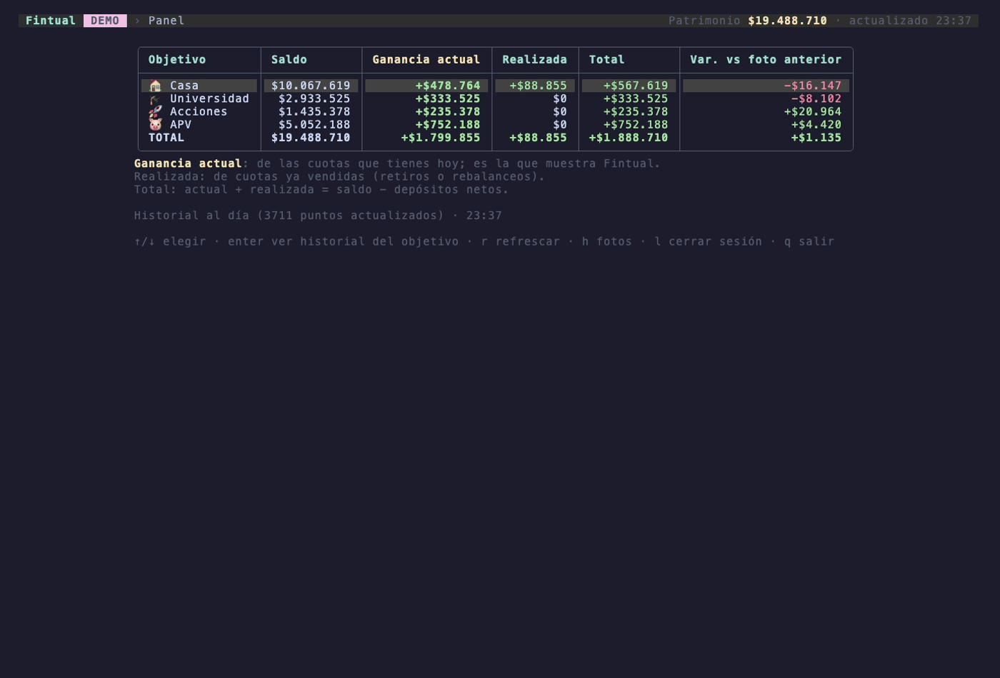
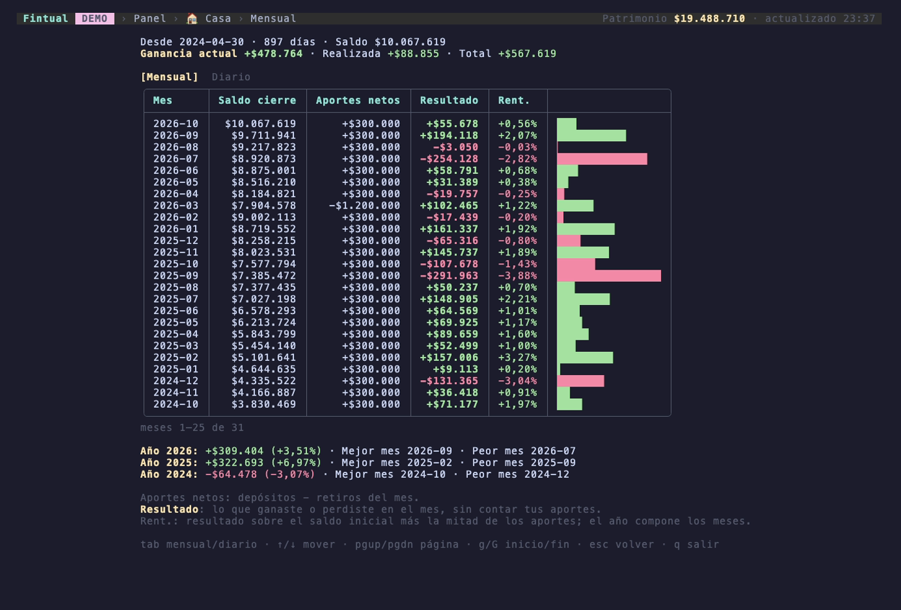
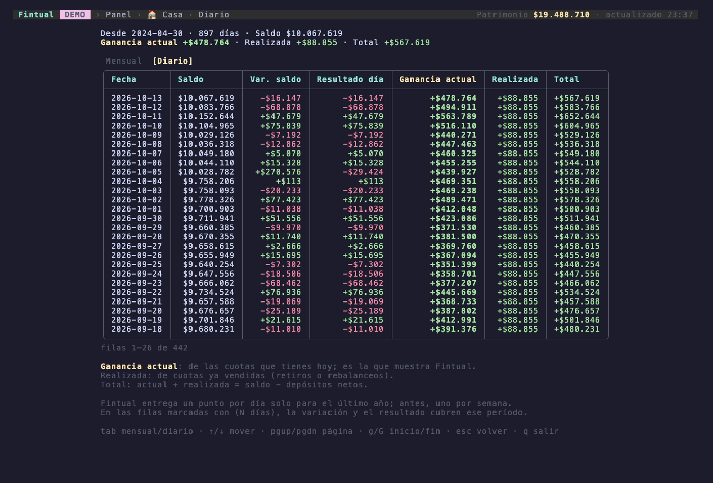

# goinv

Sigue tus inversiones en [Fintual](https://fintual.cl) (Chile) desde la terminal: saldos del día, ganancia y la historia de cada objetivo, mes a mes y día a día.

> **App no oficial.** No está afiliada a Fintual ni respaldada por ellos. Usa la misma API interna que la web de fintual.cl, que no es pública y puede cambiar sin aviso; si eso pasa, la app puede dejar de funcionar.



*Las imágenes usan datos inventados del [modo demo](#probar-sin-cuenta).*

## Qué hace

- **Panel del día:** saldo de cada objetivo y el total de tu patrimonio, con:
  - **Ganancia actual:** la de las cuotas que tienes hoy. Es la misma cifra que muestra Fintual.
  - **Realizada:** la de cuotas ya vendidas (retiros o rebalanceos).
  - **Total:** actual + realizada (= saldo − depósitos netos).
  - **Variación** respecto de la foto anterior.
- **Foto diaria:** cada vez que abres la app (o corres `goinv snapshot`) guarda el saldo de cada objetivo en una base local, una vez por día.
- **Historia de cada objetivo desde que lo abriste**, cargada desde Fintual:
  - **Mensual:** saldo al cierre, aportes netos, resultado del mes (sin contar tus aportes), rentabilidad y un resumen por año con el mejor y peor mes.
  - **Diaria:** saldo, variación y resultado de cada día. Fintual entrega un punto por día solo para el último año; antes, uno por semana. La app guarda lo que descarga, así que desde que empiezas a usarla tu historia diaria se va acumulando más allá de ese año.

Incluye objetivos normales, reservas, APV (A, B y depósito convenido) e inversiones con distribución personalizada.

### Capturas

**Panel del día:** saldo, las tres ganancias y la variación de cada objetivo.


**Historia mensual de un objetivo:** aportes, resultado y rentabilidad de cada mes, con un resumen por año.



**Historia diaria:** el día 5 el saldo sube por el aporte, pero el resultado del día muestra solo lo que se movió la inversión.



## Requisitos

- Una cuenta de **Fintual Chile con contraseña**. Si entras con Google o Apple, crea una contraseña con "¿Olvidaste tu contraseña?" en el login con email de Fintual.
- **Go 1.26.9 o superior.** Si tienes una versión anterior y `GOTOOLCHAIN=auto` (el valor por defecto), Go descarga la versión correcta solo.
- Probada en **macOS**. Debería funcionar en Linux (con un llavero compatible con Secret Service, como GNOME Keyring) y en Windows, pero no está probada ahí.

## Instalación

**Con `go install`** (recomendado si solo quieres usarla):

```sh
go install github.com/kalelc/go-investment/cmd/goinv@latest
goinv
```

Go instala el programa en `$(go env GOPATH)/bin` (normalmente `~/go/bin`). Si después `goinv` responde *command not found*, esa carpeta no está en tu `PATH`. Agrégala en tu `~/.zshrc` (o `~/.bashrc`) y abre una terminal nueva:

```sh
export PATH="$(go env GOPATH)/bin:$PATH"
```

Si usas un gestor de versiones como goenv, la carpeta depende de la versión de Go (por ejemplo `~/go/1.26.1/bin`); el comando de arriba siempre apunta a la correcta. Para actualizar, vuelve a correr el mismo `go install`.

**Desde el código** (si quieres modificarla):

```sh
git clone https://github.com/kalelc/go-investment.git
cd go-investment
make run        # corre la app sin instalarla
make install    # o instálala como goinv (te avisa si falta agregarla al PATH)
```

## Probar sin cuenta

```sh
goinv demo      # o make demo desde el código
```

Abre la app completa con datos inventados: no se conecta a Fintual, no pide login y no toca tu llavero ni tu base de datos (usa un servidor falso, un llavero en memoria y una base temporal que se borra al salir).

## Uso

```sh
goinv           # abre la app (o make run desde el código)
```

La primera vez te pide email y contraseña; Fintual te envía un **código de verificación al email** y lo ingresas en la app. Después la sesión se reutiliza hasta que Fintual la expire, y entonces la app vuelve a pedirte el login.

| Pantalla | Teclas |
|---|---|
| Login | `enter` continuar · `tab` cambiar campo · `esc` salir |
| Panel | `↑/↓` elegir objetivo · `enter` ver su historia · `r` refrescar · `h` fotos guardadas · `l` cerrar sesión · `q` salir |
| Objetivo | `tab` mensual/diario · `↑/↓` mover · `pgup/pgdn` página · `g/G` inicio/fin · `esc` volver |

Otros comandos (entre paréntesis, el equivalente desde el código):

```sh
goinv snapshot        # guarda la foto del día sin abrir la app; sirve para cron y no pide login (make snapshot)
goinv history [días]  # muestra las fotos guardadas, por defecto 30 días (make history DAYS=7)
goinv status          # muestra hace cuánto iniciaste sesión (make status)
goinv logout          # borra la sesión guardada (make logout)
```

Variables de entorno:

| Variable | Uso |
|---|---|
| `GOINV_DB` | Ruta a la base SQLite (por defecto `~/.local/share/goinv/goinv.db`). |
| `GOINV_DEBUG` | Si está definida, registra detalles de las respuestas de Fintual (sin secretos). En la app van a `~/.local/share/goinv/debug.log`. |

## Seguridad

**La app solo lee. No hace transacciones:** no deposita, no retira, no rescata, no cambia el riesgo de tus objetivos ni modifica nada en tu cuenta. El código lo deja verificable:

- Las únicas consultas a Fintual son tres **consultas de lectura** GraphQL (`GoinvObjects`, `GoinvBalance` y `GoinvBalanceHistory`, en `internal/fintual/`). No existe ninguna `mutation`, que es como GraphQL modifica datos.
- Las únicas direcciones que llama son los dos pasos del login (`/auth/sessions/initiate_login` y `/auth/sessions/finalize_login_web`) y la API de consultas (`/gql/`).

Además:

- **Tu contraseña nunca se guarda**, ni en disco ni en logs. Se usa solo durante el login y se descarta.
- **La sesión se guarda en el llavero del sistema** (Keychain en macOS), no en un archivo.
- **Todo viaja por HTTPS** a `fintual.cl`, con certificados verificados. La app bloquea redirecciones a otros dominios, para que tus credenciales no puedan terminar en otro sitio.
- **El texto que viene de Fintual se limpia** de caracteres de control antes de mostrarlo en la terminal.
- **Tus datos quedan solo en tu computador**, en `~/.local/share/goinv/`, con permisos solo para tu usuario. La app no envía datos a ningún otro servicio.
- **Los logs de debug no registran secretos:** ni contraseñas, ni códigos, ni cookies.
- Puedes revisar las dependencias y la versión de Go en busca de vulnerabilidades conocidas con [`govulncheck`](https://pkg.go.dev/golang.org/x/vuln/cmd/govulncheck) (ver [Desarrollo](#desarrollo)).

**Ten en cuenta:**

- La sesión guardada es la misma que usa la web de Fintual: **mientras esté vigente, da acceso completo a tu cuenta**, aunque la app solo la use para leer. Cualquiera con acceso a tu computador desbloqueado podría usarla. Si dejas de usar la app, corre `goinv logout`.
- La base local con tus saldos e historia **no está cifrada**; la protegen los permisos de la carpeta.

## Desarrollo

```sh
make test       # tests
make vet        # go vet
go run golang.org/x/vuln/cmd/govulncheck@latest ./...   # vulnerabilidades conocidas
make screenshots   # regenera las imágenes de docs/ con el modo demo (requiere VHS: brew install vhs)
```

| Paquete | Qué contiene |
|---|---|
| `cmd/goinv` | Punto de entrada y comandos. |
| `internal/fintual` | Cliente de Fintual: login con código y consultas GraphQL. |
| `internal/session` | Sesión en el llavero del sistema. |
| `internal/store` | Base SQLite: fotos diarias e historia de saldos. |
| `internal/app` | Casos de uso compartidos por la app y los comandos. |
| `internal/demo` | Modo demo: datos generados y un servidor falso de Fintual. |
| `internal/tui` | App de terminal ([Bubble Tea](https://github.com/charmbracelet/bubbletea) y [Lip Gloss](https://github.com/charmbracelet/lipgloss)). |
